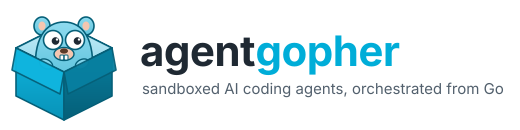
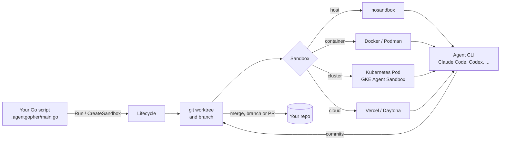
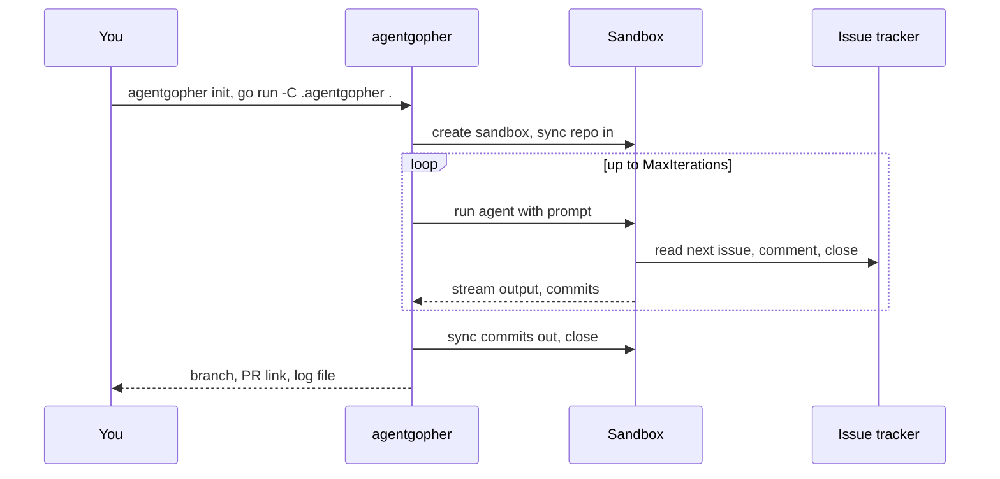

<p align="center">
  
</p>

<p align="center">
  <strong>Orchestrate sandboxed AI coding agents from Go.</strong><br>
  Point an agent at your issue tracker, give it an isolated sandbox, and get pull requests back.
</p>

<p align="center">
  <a href="https://github.com/e11en/agentgopher/actions/workflows/ci.yml"></a>
  
  
  
</p>

---

agentgopher is a Go library and CLI that runs AI coding agents in a loop: pick
an issue, work on it inside a sandbox, commit, repeat, open a pull request. You
write the orchestration in a few lines of Go; agentgopher handles worktrees,
sandboxes, prompts, logs, timeouts, session resume and the push-and-PR flow. It
is a Go port of [sandcastle](https://github.com/mattpocock/sandcastle) with Jira
and Windshift as issue trackers and first-class Kubernetes support.

```go
res, err := agentgopher.Run(ctx, agentgopher.RunOptions{
	Name:          "worker",
	Agent:         agent.ClaudeCode("claude-opus-4-8", nil),
	Sandbox:       docker.New(nil),
	PromptFile:    "./prompt.md",
	MaxIterations: 10,
})
```

## Why agentgopher

| | |
|---|---|
| **Any agent** | Claude Code, Codex, Cursor, GitHub Copilot CLI, OpenCode and Pi, behind one `agent.Provider` interface. Switch with one line. |
| **Any sandbox** | On the host, in Docker or Podman, in a Kubernetes Pod, in a GKE Agent Sandbox (gVisor, warm pools), on Vercel or Daytona. Custom providers implement one small interface. |
| **Any tracker** | GitHub Issues, Jira, Windshift, Beads, or your own CLI. The prompt templates call the tracker; agentgopher does not care which one. |
| **Safe by default** | Each run gets its own git worktree and branch. Isolated sandboxes receive the repo as a git bundle and return commits as patches; nothing else leaves the box. Kubernetes Pods run under gVisor unless you opt out. |
| **Observable** | Live streaming of the agent's output, a log file per run, idle and completion timeouts, structured output extraction with retries. |
| **Resumable** | Claude Code, Codex and Pi sessions can be resumed or forked across runs, even across sandboxes. |
| **Scales out** | `agentgopher remote run` starts the whole orchestration as a Kubernetes Job on GKE, streams the log, and prints the pull requests it opened. Terraform and manifests included. |

## How it works



One `Run` is a loop of up to `MaxIterations` agent invocations on the same
branch. Each iteration gets the rendered prompt, runs until the agent prints
the completion signal or goes idle, and leaves commits behind. Templates
chain several runs: plan, implement in parallel, review, merge.



## Quick start

```bash
export GOPRIVATE=github.com/e11en   # private module: go needs git auth
go install github.com/e11en/agentgopher/cmd/agentgopher@latest

cd your-repo
agentgopher init                    # pick agent, sandbox, issue tracker, template
agentgopher docker build-image      # sandbox image with git plus the agent CLI
cp .agentgopher/.env.example .agentgopher/.env   # add your agent and tracker tokens
go run -C .agentgopher .            # run the orchestration
```

`init` writes `.agentgopher/` with a `main.go` you own, a Dockerfile, prompt
templates and a `.env.example`. Edit the prompts, change the template, add
hooks: it is plain Go.

### Templates

| Template | What it does |
|---|---|
| `simple-loop` | Picks issues one by one and closes them |
| `sequential-reviewer` | Implements issues one by one, with a code review step after each |
| `parallel-planner` | Plans parallelizable issues, executes on separate branches, merges |
| `parallel-planner-with-review` | Same, with a per-branch review before the merge |
| `blank` | Bare scaffold: write your own prompt and orchestration |

### Run it on GKE

```bash
terraform -chdir=deploy/terraform apply          # Autopilot cluster, registry, secrets, Agent Sandbox add-on
kubectl kustomize deploy/k8s | kubectl apply -f -  # namespace, RBAC, secrets CSI, sandbox warm pool
agentgopher remote run --repo https://github.com/you/your-repo.git
```

The Job clones the repo, runs your `.agentgopher` script with each agent in a
gVisor-isolated sandbox from the warm pool, pushes the branch and opens the
pull request. Ctrl-C leaves the Job running and tells you how to follow it.
Full setup: [docs/kubernetes.md](docs/kubernetes.md).

## The library

| API | Use it for |
|---|---|
| `agentgopher.Run` | One agent loop on a fresh branch or worktree |
| `agentgopher.CreateSandbox` | A long-lived sandbox for several runs that share state, for example implement then review |
| `agentgopher.CreateWorktree` | A worktree you control, with `Run`, `CreateSandbox` and `Interactive` on it |
| `agentgopher.Interactive` | Drop into the agent's own terminal UI inside the sandbox |
| `agentgopher.OutputObject` / `OutputString` | Typed, validated output from the agent with automatic retries |
| `RunResult.Resume` / `Fork` | Continue or branch a captured session |
| `agentgopher.Hooks` | Host and sandbox commands before and after the agent, for example `npm install` |

Prompts are files with `{{KEY}}` placeholders and `` !`command` `` expansion
that runs inside the sandbox, so a prompt can embed the tracker's issue list.

### Providers

| Sandbox | Package | Isolation | Notes |
|---|---|---|---|
| Host | `sandbox/nosandbox` | none | Fastest, for trusted repos |
| Docker, Podman | `sandbox/docker`, `sandbox/podman` | container, bind-mounted worktree | Image built from `.agentgopher/Dockerfile`, UID aligned with the host |
| Kubernetes Pod | `sandbox/kubernetes` | Pod under gVisor | Any cluster; `RuntimeClass: kubernetes.NoRuntimeClass` opts out of gVisor |
| GKE Agent Sandbox | `sandbox/agentsandbox` | gVisor, managed network policy | Claimed from a warm pool through the official SDK |
| Vercel Sandbox | `sandbox/vercel` | microVM | `sandbox` CLI, `VERCEL_TOKEN` |
| Daytona | `sandbox/daytona` | cloud sandbox | Official Go SDK, `DAYTONA_API_KEY` |

Isolated providers (everything except host and containers) get the repo as a
git bundle and return commits as patches. A patch that fails to apply is kept
under `.agentgopher/patches/` with the recovery commands on stderr.

| Agent | Package | Sessions |
|---|---|---|
| Claude Code | `agent.ClaudeCode` | resume and fork |
| Codex | `agent.Codex` | resume and fork |
| Pi | `agent.Pi` | resume and fork |
| Cursor | `agent.Cursor` | |
| GitHub Copilot CLI | `agent.Copilot` | |
| OpenCode | `agent.OpenCode` | |

## Examples

```bash
go run ./examples/simple /path/to/repo              # host, one iteration
go run ./examples/docker /path/to/repo              # Docker, see the file header for the image build
go run ./examples/isolated vercel /path/to/repo     # vercel, daytona or agent-sandbox
```

## Documentation

- [docs/kubernetes.md](docs/kubernetes.md): GKE setup, `remote run`, sandboxes inside the cluster
- [docs/plan.md](docs/plan.md): design, decisions and the roadmap
- `docs/superpowers/plans/`: the implementation plans per phase

## Status

Phases 1 to 8 of the plan are done and covered by unit tests, lint and CI.
The GKE deployment is validated with `terraform validate` and `kustomize`;
an end-to-end run on a real cluster is the next step.
